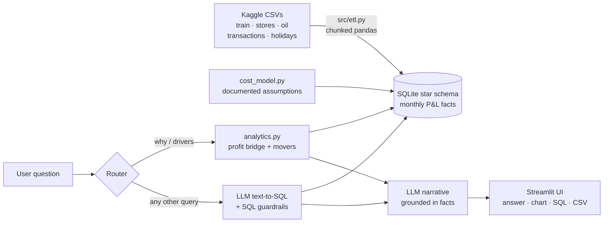

# 📊 Generative AI Financial Reporting & Business Intelligence Assistant

Ask finance questions about a supermarket chain in plain English, like *"Why did operating profit decline in 2015?"*, and get a grounded answer, a chart, the SQL behind it, and an automated management report.

**Tech:** Python · SQL (SQLite star schema) · LLM API (Anthropic Claude or OpenAI) · Streamlit · Plotly · pytest · GitHub Actions

**Business outcome:** less manual monthly reporting, and business insights that non-technical managers can get on their own.

> 🔗 **Live demo:** `https://<your-app>.streamlit.app` · **Data:** Kaggle – Corporación Favorita Store Sales (≈3M rows, 54 stores, 33 product families, 2013–2017)

---

## ✨ Features

| Feature | What it does |
|---|---|
| 💬 **Natural-language Q&A** | The LLM turns a question into SQL, runs it read-only against the warehouse, and explains the result |
| 🔍 **"Why did profit change?" engine** | Deterministic **operating-profit bridge**: revenue volume, product mix, margin rate & promo markdowns, labor, occupancy, fuel-linked logistics, overhead. The LLM explains the numbers but never makes them up |
| 📝 **Automated executive summary** | One-click CFO report for any month, quarter or year, compared with the prior period and with last year; downloadable as Markdown |
| 📈 **P&L explorer** | Filter by store type / city; monthly trends and an annual P&L table |
| 🛡️ **Guardrails** | SELECT-only SQL validation, read-only DB connection, row limits, one automatic SQL self-correction retry |
| 🔌 **Works without an API key** | Offline mode uses rule-based SQL templates, so the public demo always works |

## 🏗️ Architecture



**Data model:** `dim_store`, `dim_month`, `dim_holiday`, `fact_sales_monthly` (store × family × month), `fact_store_pnl_monthly` (full P&L), `fact_oil_monthly`, plus views `v_company_pnl_monthly`, `v_store_pnl_monthly`, `v_family_pnl_monthly`.

### Why a cost model?
The Kaggle data has actual **revenue, promotions, transactions and oil prices**, but no costs. To answer real FP&A questions, `src/cost_model.py` adds a transparent P&L layer: gross margin by product family, promo markdowns that grow with promotion intensity, store labor and rent by store format, logistics per transaction indexed to WTI oil, and corporate overhead. Every assumption is shown in the app's **Data & assumptions** tab.

## 🚀 Quick start (GitHub Codespaces, nothing to install)

1. Open the repo on GitHub → **Code → Codespaces → Create codespace**. Dependencies install automatically.
2. Run the app with demo data:
   ```bash
   streamlit run app.py
   ```
   If no database exists yet, a synthetic dataset in the same format as the Kaggle data is generated on first run.
3. **Use the real Kaggle data.** Add `KAGGLE_USERNAME` / `KAGGLE_KEY` as Codespaces secrets, accept the [competition rules](https://www.kaggle.com/competitions/store-sales-time-series-forecasting/rules), then:
   ```bash
   bash scripts/download_data.sh
   ```
   Or upload the 5 CSVs into `data/raw/` and run `python -m src.etl`.
4. **Turn on AI answers.** Set `ANTHROPIC_API_KEY` (or `OPENAI_API_KEY`) as a secret or in `.env`.

## 💡 Example questions
- Why did operating profit decline in 2015?
- Explain the profit change in Q3 2016 vs Q3 2015
- Top 10 stores by operating profit in 2016
- Which product families drive the most gross profit?
- How do promotions affect gross margin?
- How did oil prices affect logistics cost?
- What happened to sales in April 2016? *(Ecuador earthquake month)*

## 🧪 Tests
```bash
pytest -q
```
The tests cover SQL injection guardrails, profit-bridge reconciliation (the steps always sum exactly), period parsing, offline routing, and the LLM path (using a fake LLM, including SQL self-correction). CI runs on every push via GitHub Actions.

## 📁 Project structure
```
├── app.py                  # Streamlit UI (4 tabs)
├── src/
│   ├── etl.py              # Kaggle CSV → SQLite (chunked, ~3M rows)
│   ├── cost_model.py       # Documented P&L assumptions
│   ├── analytics.py        # Period parsing, P&L, profit bridge, movers
│   ├── assistant.py        # Router: explain-change / text-to-SQL / offline
│   ├── llm.py              # Claude / OpenAI / offline client
│   ├── prompts.py          # All prompt templates
│   ├── db.py               # Read-only SQL execution + guardrails
│   └── sample_data.py      # Synthetic data in Kaggle format
├── sql/schema.sql          # Star schema + reporting views
├── scripts/download_data.sh
├── tests/test_pipeline.py
└── .devcontainer/          # One-click Codespaces setup
```

## ☁️ Deploy (Streamlit Community Cloud, free)
1. Go to [share.streamlit.io](https://share.streamlit.io), sign in with GitHub, click **New app**, and pick this repo with `app.py` as the main file.
2. Under **Advanced settings → Secrets**, add `ANTHROPIC_API_KEY = "..."` (optional).
3. Deploy. The public demo runs on synthetic data in the Kaggle format, so no Kaggle data gets redistributed.

## 📜 Data & license
Data: *Store Sales – Time Series Forecasting*, Kaggle (Corporación Favorita). Raw data is not committed; download it from Kaggle under the competition's rules. Cost figures are modeled assumptions for demonstration, not Favorita's actual financials.

---
**Author:** Abrar Ahmed Syed, Business Data / Financial & AI Analyst · [LinkedIn](https://www.linkedin.com/in/abrar313) · [Portfolio](https://abuabrar09.github.io) · [GitHub](https://github.com/Abuabrar09)
